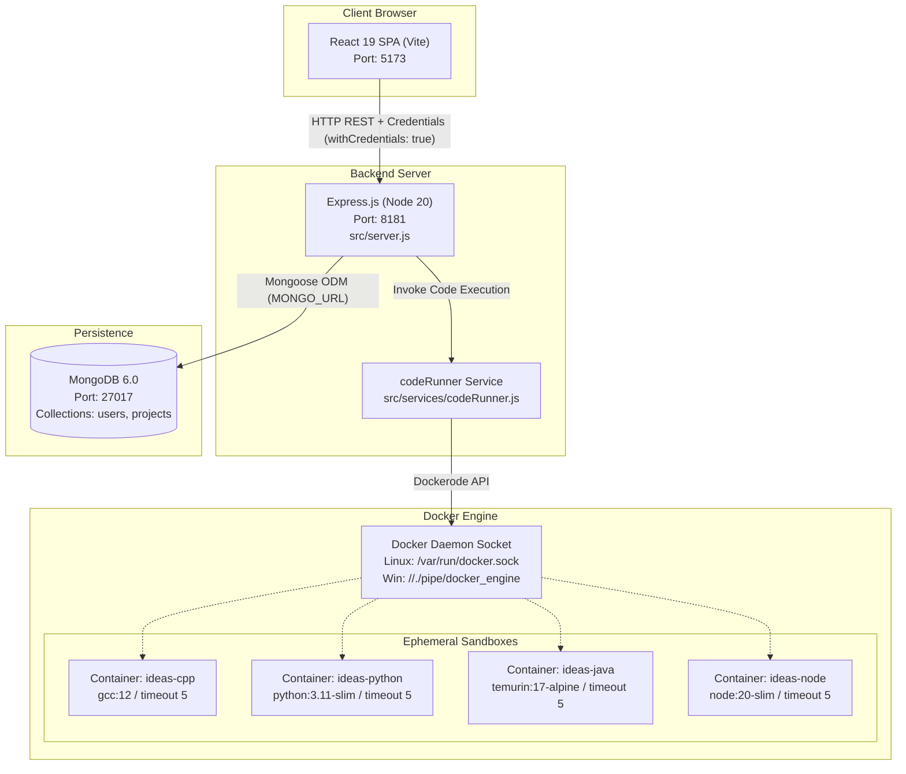

# 02 — System Architecture

This document specifies the end-to-end architecture, process model, port allocations, and container isolation design of IDEas Online IDE.

---

## 1. System Topology Overview

The application comprises three independent application tiers and an external container orchestration engine:



---

## 2. Network & Port Allocations

| Service | Port | Protocol | Binding / Host Exposure | Description |
|:---|:---|:---|:---|:---|
| **Frontend** | `5173` | HTTP | `0.0.0.0:5173` (`--host`) | Vite development server serving the React 19 application. |
| **Backend API** | `8181` | HTTP | `0.0.0.0:8181` | Express.js REST API providing auth, project storage, and execution endpoints. |
| **MongoDB** | `27017` | TCP | `localhost:27017` | Standalone MongoDB 6 database server. |
| **Docker Socket** | N/A | IPC / Unix Socket | `/var/run/docker.sock` or `//./pipe/docker_engine` | Direct communication channel used by `dockerode` to control the host engine. |

### DNS Hardcoding
In `server/src/server.js` (line 12), the backend hardcodes Google Public DNS servers:
```javascript
import dns from "dns";
dns.setServers(['8.8.8.8', '8.8.4.4']);
```
This forces all DNS resolutions within the Node.js process to bypass local/VPN resolvers.

---

## 3. Sandboxing & Security Isolation Model

The code execution engine (`server/src/services/codeRunner.js`) isolates untrusted code using ephemeral Docker containers. Every execution creates a fresh container based on pre-built images with the following safety boundaries:

```
                          Host Server (Node.js)
                             │
                             │ Creates Container via Dockerode
                             ▼
         ┌────────────────────────────────────────────────────────┐
         │ Ephemeral Container (ideas-cpp / ideas-python / etc.)  │
         │                                                        │
         │  1. Non-Root Execution: USER coderunner                │
         │  2. Memory Cap:        256 MB (256 * 1024 * 1024)      │
         │  3. CPU Quota:         50000 (50% of one CPU core)    │
         │  4. Network Isolation: NetworkMode: "none"             │
         │  5. Storage Mounting:  server/temp/<id> -> /code       │
         │  6. Execution Timeout: timeout 5 <command>             │
         └────────────────────────────────────────────────────────┘
```

1. **Least Privilege User**:
   - Every Dockerfile in `server/docker/*/Dockerfile` creates an unprivileged user:
     ```dockerfile
     RUN useradd -m coderunner
     USER coderunner
     WORKDIR /code
     ```
   - Code cannot write to root system paths or install packages.
2. **Resource Constraints**:
   - Enforced in `docker.createContainer()` via `HostConfig`:
     - `Memory: 256 * 1024 * 1024` (256 MB limit prevents memory-exhaustion DoS).
     - `CpuQuota: 50000` (Restricts execution to at most 50% of a single CPU core).
3. **Complete Network Disconnection**:
   - `NetworkMode: "none"` completely disables network interfaces inside the container. Code cannot make outbound socket calls, download malicious payloads, or participate in DDoS attacks.
4. **Volume Mount**:
   - The container mounts only the specific submission directory:
     ```javascript
     Binds: [`${tempDir}:/code`]
     ```
   - The container cannot inspect other submissions or access host files.
5. **Execution Timeout**:
   - Containers enforce a hard 5-second execution timeout via shell: `timeout 5 <command> 2>&1`.

---

## 4. Authentication Architecture

The platform uses a stateless cookie-based JSON Web Token (JWT) scheme:

```
[Browser]                                               [Express Server]
   │                                                           │
   │─── POST /user/login (email, password) ───────────────────>│
   │                                                           │── Authenticate against MongoDB
   │                                                           │── Sign JWT { uid, role }
   │<── 200 OK + Set-Cookie: accessToken ──────────────────────│
   │    (httpOnly: true, secure: true, sameSite: "lax")        │
   │                                                           │
   │─── GET /user/me (Cookie sent automatically) ─────────────>│
   │                                                           │── jwt.verify(cookie)
   │<── 200 OK { user: { email, username } } ──────────────────│
```

* **No Web Storage**: The token is never exposed to JavaScript (`httpOnly: true`), mitigating XSS token extraction.
* **CORS & Credentials**:
  - `server/src/server.js`: Configured with `cors({ origin: "http://localhost:5173", credentials: true })`.
  - `client/src/API/userAPI.js`: Configured with `axios.create({ withCredentials: true })`.

---

## 5. Architectural Failure Points & Risks

* **Horizontal Privilege Escalation (FP-07)**:
  `server/src/controller/userController/userController.js` (line 183) updates projects using `{"owner": req.body.id}` without verifying if the requesting user's `uid` matches the project author. Any authenticated user can overwrite another's project.
* **Unauthenticated Workspace Reads (FP-08)**:
  `server/src/routes/UserRouter/UserRoutes.js` (line 11) does not apply authentication middleware to `GET /project/:id`. Any anonymous visitor with a project UUID can read the complete file tree.
* **Host Socket Access**:
  Mounting `/var/run/docker.sock` into the backend gives the backend container root-level control over the host Docker daemon.

---

## Next Steps & References
* For detailed frontend component relationships, see [03-frontend-architecture.md](./03-frontend-architecture.md).
* For backend controller pipelines, see [04-backend-architecture.md](./04-backend-architecture.md).
* For the failure-point register, see [09-debugging-playbook.md](./09-debugging-playbook.md).
