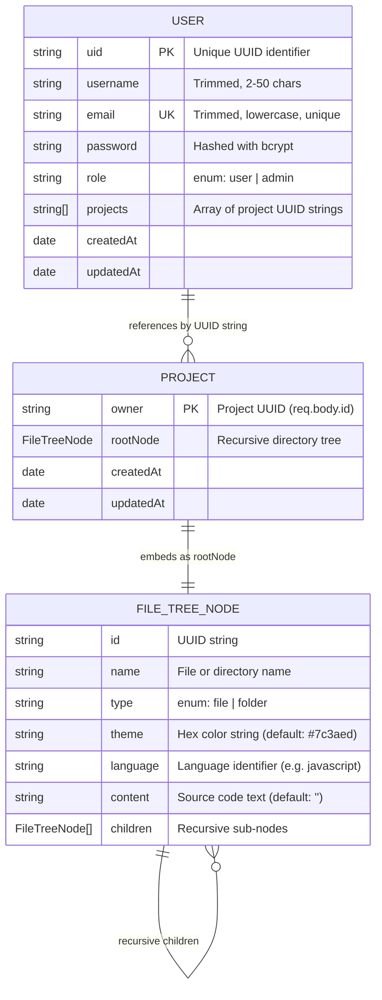

# 06 — Database Schema & Data Models

This document defines the MongoDB database design, Mongoose schemas, data dictionaries, relationships, and schema caveats for IDEas Online IDE.

---

## 1. Database Connection Configuration

Connection logic is implemented in `server/src/db/mongoConnect.js`:

```javascript
import mongoose from "mongoose";

export default async function dbConnection() {
  try {
    const conn = await mongoose.connect(process.env.MONGO_URL);
    console.log(`MongoDB Connected: ${conn.connection.host}`);
  } catch (error) {
    console.error(`Error connecting to MongoDB: ${error.message}`);
  }
}
```

* **Connection String**: Read from `process.env.MONGO_URL`.
* **Engine**: MongoDB 6.0 (supported by Mongoose 8.x).
* **Collections**: `users`, `projects`.

---

## 2. Entity-Relationship Diagram



---

## 3. Data Dictionary

### Collection: `users` (`server/src/model/UserModel.js`)

```javascript
const userSchema = new mongoose.Schema({
  uid: { type: String, unique: true, required: true },
  username: { type: String, required: true, trim: true, minlength: 2, maxlength: 50 },
  email: { type: String, required: true, unique: true, lowercase: true, trim: true },
  password: { type: String, required: true, minlength: 8 },
  role: { type: String, enum: ["user", "admin"], default: "user" },
  projects: { type: [String], required: false, default: [] }
}, { timestamps: true });
```

| Field Name | Type | Constraints / Rules | Description |
|:---|:---|:---|:---|
| `uid` | `String` | Required, Unique, Indexed | UUID v4 assigned during signup (`res.locals.uid`). Acts as primary user ID. |
| `username` | `String` | Required, Trimmed, Min: 2, Max: 50 | Display handle shown in Navbar and Dashboard. |
| `email` | `String` | Required, Unique, Lowercase, Trimmed | Unique login credential. |
| `password` | `String` | Required, Min: 8 | Bcrypt-hashed password string. |
| `role` | `String` | Enum: `["user", "admin"]`, Default: `"user"` | User authorization level. |
| `projects` | `[String]` | Array of Strings, Default: `[]` | List of project UUID strings owned by this user. |
| `createdAt` | `Date` | Automated by Mongoose | Timestamp of registration. |
| `updatedAt` | `Date` | Automated by Mongoose | Timestamp of last profile update. |

---

### Collection: `projects` (`server/src/schemas/projectSchema.js`)

```javascript
const FileTreeNodeSchema = new mongoose.Schema();
FileTreeNodeSchema.add({
  id: { type: String, required: true },
  name: { type: String, required: true, trim: true },
  type: { type: String, enum: ['file', 'folder'], required: true },
  theme: { type: String, default: '#7c3aed' },
  language: { type: String },
  content: { type: String, default: '' },
  children: [FileTreeNodeSchema],
});

const ProjectSchema = new mongoose.Schema({
  owner: { type: String, ref: 'User', required: true },
  rootNode: { type: FileTreeNodeSchema, required: true },
}, { timestamps: true });

export const Project = mongoose.model('Project', ProjectSchema);
```

| Field Name | Type | Constraints / Rules | Description |
|:---|:---|:---|:---|
| `owner` | `String` | Required | **Note**: Holds the project UUID (`req.body.id`), not the user's `uid`. |
| `rootNode` | `FileTreeNode` | Required, Embedded Subdocument | The root directory node of the virtual filesystem. |
| `rootNode.id` | `String` | Required | UUID matching `owner`. |
| `rootNode.name` | `String` | Required, Trimmed | Display name of the project. |
| `rootNode.type` | `String` | Enum: `['file', 'folder']` | Root node is always `"folder"`. |
| `rootNode.theme`| `String` | Default: `"#7c3aed"` | Selected color theme hex code. |
| `rootNode.language` | `String` | Optional | Language mode identifier. |
| `rootNode.content` | `String` | Default: `""` | File content string (blank for folders). |
| `rootNode.children`| `[FileTreeNode]`| Recursive Array | Nested files and directories. |
| `createdAt` | `Date` | Automated by Mongoose | Timestamp of project creation. |
| `updatedAt` | `Date` | Automated by Mongoose | Timestamp of last tree save. |

---

## 4. Relationship Mechanics & Architectural Caveats

1. **Weak Foreign Key References**:
   - `ProjectSchema` sets `owner: { type: String, ref: 'User' }`. Because `owner` is a plain `String` storing the project UUID, Mongoose `.populate('owner')` **will not work**, as Mongoose expects an `ObjectId` matching `User._id`.
2. **Missing `select: false` on Password**:
   - `password` in `UserModel.js` is not marked `select: false`. Queries like `User.findOne({ uid })` will return the hashed password unless explicitly excluded with `.select("-password")` (as done in `userController.js:77`).
3. **Recursive Document Depth**:
   - Storing deep directory structures in a single nested subdocument means large projects could approach MongoDB's 16 MB BSON document limit. For typical coding exercises, this limit is unlikely to be reached.

---

## Next Steps & References
* For how the API queries these schemas, see [05-api-reference.md](./05-api-reference.md).
* For workspace saving and the disconnected buffer defect, see [features/project-workspace.md](./features/project-workspace.md).
