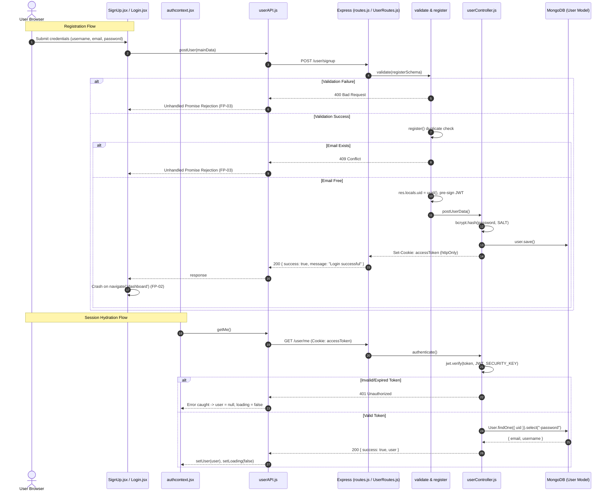

# Feature Trace — Authentication & Session Management

This document details the complete end-to-end execution flow for user registration, login, cookie-based session hydration, and route guarding.

---

## 1. Feature Architecture Overview

Authentication in IDEas is stateless and cookie-based. The browser does not store tokens in JavaScript-accessible storage (`localStorage` or `sessionStorage`). Instead:
1. The server signs a JSON Web Token (JWT) on registration or login.
2. The server sets an `accessToken` cookie with `httpOnly: true`, `secure: true`, and `sameSite: "lax"`.
3. Client requests pass `withCredentials: true` via Axios, automatically transmitting the cookie.
4. On app startup, `AuthProvider` queries `GET /user/me` to hydrate the user state.

---

## 2. Sequence Diagram



---

## 3. Step-by-Step Execution Traces

### Flow A: User Registration (`/signup`)
1. **User Action**: Fills out username, email, password, confirm password and clicks "Create your account".
2. **Component & Handler**: `client/src/pages/SignUp.jsx`: `onSubmit(data)` (line 28).
3. **Form Validation**: Evaluated locally via `zodResolver(SignupSchema)` (`client/src/validation/signupSchema.js`):
   - Username: min 3 chars.
   - Email: valid email ending with `.com`.
   - Password: min 8 chars, uppercase, number, special character.
   - `confirm_password`: refined to match `password`.
4. **Data Preparation**: `const { confirm_password, ...mainData } = data;` strips confirm field.
5. **API Request**: Calls `postUser(mainData)` (`client/src/API/userAPI.js`):
   - Method: `POST`
   - URL: `http://localhost:8181/user/signup`
   - Payload: `{ username, email, password, role: "user" }`
6. **Backend Routing & Middleware**:
   - `server/src/routes/UserRouter/UserRoutes.js` dispatches:
     ```javascript
     UserRouter.post('/signup', [validate(registerSchema), register, postUserData]);
     ```
   - `validate(registerSchema)`: Re-validates payload on server using Zod.
   - `register` middleware (`server/src/middlewares/userSignup.js`):
     - Queries `User.findOne({ email: req.body.email })`. If found, returns `409 Conflict`.
     - Generates `res.locals.uid = randomUUID()`.
     - Pre-signs JWT: `jwt.sign({ uid, role: "user" }, JWT_SECURITY_KEY, { expiresIn, issuer, audience })`.
     - Stores token in `res.locals.token`.
7. **Controller Execution**:
   - `postUserData` (`server/src/controller/userController/userController.js:35`):
     - Hashes password: `await bcrypt.hash(password, Number(process.env.SALT))`.
     - Creates `new User({ uid, username, email, password: hashedPassword })`.
     - Saves to MongoDB: `await user.save()`.
     - Sets cookie:
       ```javascript
       res.cookie("accessToken", res.locals.token, {
         httpOnly: true,
         secure: true,
         sameSite: "lax",
       });
       ```
     - Returns `200 OK` with `{ success: true, message: "Login successful" }`.
8. **Frontend Response Handling & Crash**:
   - `SignUp.jsx:32`: `if (status.data.success)` evaluates to true.
   - Invokes `checkAuth()` to hydrate session.
   - **CRASH (FP-02)**: Calls `navigate('/dashboard')`. Because `navigate` is undefined, an unhandled `ReferenceError` crashes the thread.

---

### Flow B: User Login (`/login`)
1. **User Action**: Enters email and password on `/login` and clicks submit.
2. **Component & Handler**: `client/src/pages/Login.jsx`: `onSubmit(data)` (line 26).
3. **API Request**: Calls `loginUser(data)`:
   - Method: `POST`
   - URL: `http://localhost:8181/user/login`
   - Payload: `{ email, password }`
4. **Backend Route & Controller**:
   - Route: `UserRouter.post('/login', [validate(LoginSchema), login])`.
   - `login` (`userController.js:100`):
     - Queries `User.findOne({ email }).select("+password")`.
     - If not found: Returns `401 Unauthorized` (`"invalid credentials"`).
     - Compares password: `await bcrypt.compare(password, userData.password)`.
     - If mismatch: Returns `401 Unauthorized` (`"invalid credentials"`).
     - Signs JWT: `jwt.sign({ uid: userData.uid, role: userData.role }, JWT_SECURITY_KEY, ...)`.
     - Sets `accessToken` cookie.
     - Returns `200 OK` with `{ success: true }`.
5. **Frontend Response**:
   - `Login.jsx:34`: Calls `checkAuth()`.
   - `Login.jsx:35`: Calls `navigate('/Projects')`. User lands on project library.

---

### Flow C: Session Hydration & Guarding (`GET /user/me`)
1. **Trigger**: Mounted in `client/src/contexts/authcontext.jsx` on app initialization.
2. **API Request**: Calls `getMe()`:
   - Method: `GET`
   - URL: `http://localhost:8181/user/me`
   - Cookies: Browser attaches `accessToken` automatically.
3. **Backend Controller**:
   - `authenticate` (`userController.js:66`):
     - Reads `req.cookies.accessToken`. If absent, returns `401`.
     - Verifies token: `jwt.verify(receivedToken, process.env.JWT_SECURITY_KEY)`.
     - Queries `User.findOne({ uid: decoded.uid }).select("-password")`.
     - Returns `200 OK` with `{ success: true, user: { email, username } }`.
4. **Guard Evaluation**:
   - If user exists: `ProtectedRoute` renders `<Outlet />`, `PublicOnlyRoute` redirects to `/dashboard`.
   - If user is null: `ProtectedRoute` redirects to `/login`, `PublicOnlyRoute` renders `<Outlet />`.

---

## 4. Debugging Checkpoints & Verified Defects

1. **`SignUp.jsx:34` (FP-02)**: Look for `ReferenceError: navigate is not defined` in console.
2. **`SignUp.jsx:31` (FP-03)**: Look for uncaught `AxiosError` on duplicate registration.
3. **`AuthRoute.jsx:12` (FP-09)**: Note route casing mismatch (`/dashboard` vs `/Dashboard`).
4. **Cookie Security**: In development over plain HTTP (`localhost`), ensure browsers do not reject `secure: true` cookies.

---

## Next Steps & References
* For the project workspace that authenticated users access, see [features/project-workspace.md](./project-workspace.md).
* For the failure-point register, see [09-debugging-playbook.md](../09-debugging-playbook.md).
