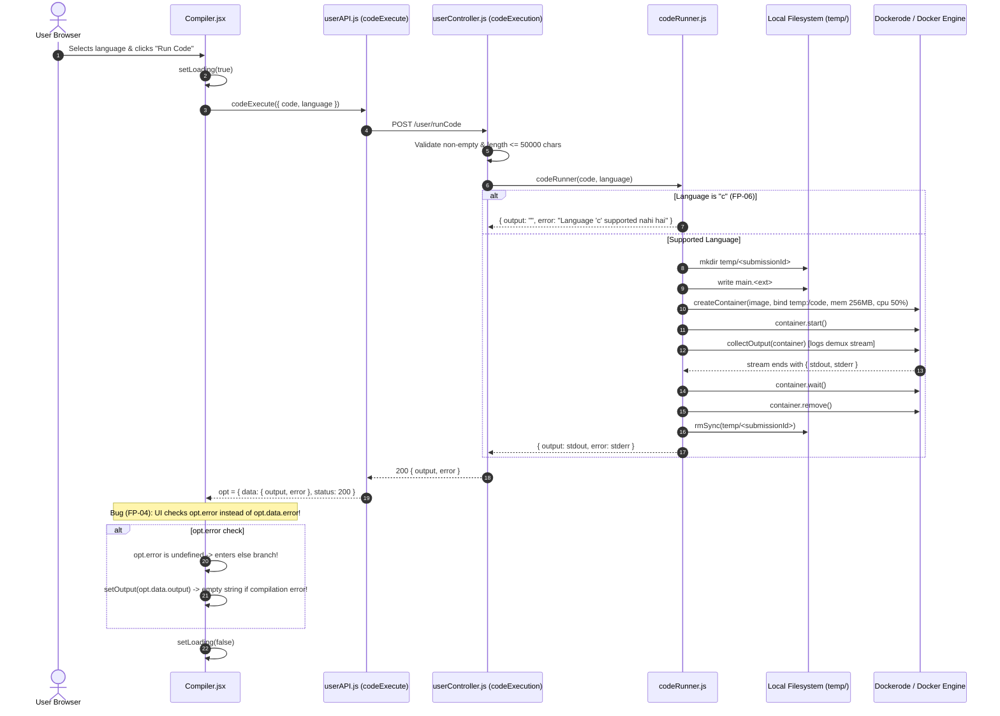

# Feature Trace — Standalone Code Execution Engine

This document details the complete end-to-end execution flow of the standalone compiler (`/Compiler`), from the user interface down through the Docker container sandboxing pipeline and output stream demuxing.

---

## 1. Feature Architecture Overview

The code execution engine runs untrusted user code inside ephemeral Docker containers without host network access or root privileges:
* **Frontend**: Split-pane interface featuring a language selector toolbar, Monaco Editor, and a simulated terminal output window.
* **Backend**: Express API endpoint (`POST /user/runCode`) that passes sanitized source code to the `codeRunner` service.
* **Service Layer**: Dockerode bridge creating container instances with tight CPU (50%), RAM (256 MB), and runtime (5 seconds) quotas.
* **Teardown**: Captures multiplexed stdout/stderr streams, deletes containers, and purges temporary files.

---

## 2. Sequence Diagram



---

## 3. Step-by-Step Execution Traces

### Step 1: Language Selection & Code Editing
* User navigates to `/Compiler`.
* `Compiler.jsx` loads default language: `"cpp"` with `languageBoilerplates.cpp`.
* Languages offered in toolbar (line 57):
  ```javascript
  const languages = ["cpp", "java", "python", "c", "javascript"];
  ```
* User modifies code inside the Monaco Editor (`@monaco-editor/react`). Keystrokes fire `handleCodeChange(value)`, updating local React state `const [code, setCode] = useState(...)`.

---

### Step 2: Execution Dispatch
* User clicks "Run Code".
* Invokes `sendCodeToExecution()` (`Compiler.jsx:64`):
  ```javascript
  setLoading(true);
  const data = { code, language };
  const opt = await codeExecute(data);
  ```
* **DEFECT (FP-05)**: No `try...catch` block. If the network drops or backend throws a 500, execution halts and `setLoading(false)` never runs. The button freezes in "Running..." state forever.

---

### Step 3: API Request & Controller Validation
* `client/src/API/userAPI.js` calls `POST http://localhost:8181/user/runCode`.
* Express routes to `codeExecution` (`server/src/controller/userController/userController.js:10`):
  1. Validates presence: `if (!code || !language) return res.status(400)`.
  2. Validates length: `if (code.length > 50000) return res.status(400)` (Max 50 KB).
  3. Calls `codeRunner(code, language)`.

---

### Step 4: Language Lookup & Temp Directory Creation
`server/src/services/codeRunner.js` manages filesystem staging:
* Normalizes line breaks: `const code = rawCode.replace(/\r\n/g, '\n')`.
* Looks up Docker image and file name:
  ```javascript
  const imageMap = {
    cpp: "ideas-cpp",
    python: "ideas-python",
    java: "ideas-java",
    javascript: "ideas-node",
  };
  const fileMap = {
    cpp: "main.cpp",
    python: "main.py",
    java: "Main.java",
    javascript: "main.js",
  };
  ```
* **DEFECT (FP-06)**: Language `"c"` is missing from `imageMap` and `fileMap`. If selected, `codeRunner` aborts immediately and returns `{ output: "", error: "Language 'c' supported nahi hai" }`.
* Generates UUID: `const submissionId = uuidv4()`.
* Creates host directory: `server/temp/<submissionId>/`.
* Writes source code: `fs.writeFileSync(path.join(tempDir, filename), code)`.

---

### Step 5: Container Creation & Execution Isolation
Calls Dockerode to spawn the sandbox container:
```javascript
container = await docker.createContainer({
  Image: image,
  Tty: false,
  HostConfig: {
    Binds: [`${tempDir}:/code`],
    Memory: 256 * 1024 * 1024, // 256 MB
    CpuQuota: 50000,           // 50% CPU
    NetworkMode: "none",        // Disconnect network
    AutoRemove: false,
  },
});
await container.start();
```

* **Runner Dockerfiles** (`server/docker/*/Dockerfile`):
  All images run under non-root `USER coderunner`, with workdir `/code`, executing a 5-second timeout command:
  - C++: `CMD ["sh", "-c", "g++ main.cpp -o main 2>&1 && timeout 5 ./main 2>&1"]`
  - Python: `CMD ["sh", "-c", "timeout 5 python3 main.py 2>&1"]`
  - Java: `CMD ["sh", "-c", "javac Main.java 2>&1 && timeout 5 java Main 2>&1"]`
  - Node.js: `CMD ["sh", "-c", "timeout 5 node main.js 2>&1"]`

---

### Step 6: Output Stream Demuxing
Docker multiplexes stdout and stderr into a single binary stream. `collectOutput(container)` separates them:
```javascript
function collectOutput(container) {
  return new Promise((resolve, reject) => {
    container.logs(
      { stdout: true, stderr: true, follow: true },
      (err, stream) => {
        if (err) return reject(err);

        let stdout = "";
        let stderr = "";

        const stdoutBucket = new PassThrough();
        const stderrBucket = new PassThrough();
        container.modem.demuxStream(stream, stdoutBucket, stderrBucket);

        stdoutBucket.on("data", (chunk) => (stdout += chunk.toString()));
        stderrBucket.on("data", (chunk) => (stderr += chunk.toString()));

        stream.on("end", () =>
          resolve({ stdout: stdout.trim(), stderr: stderr.trim() })
        );
        stream.on("error", reject);
      }
    );
  });
}
```

---

### Step 7: Teardown & Purge
1. Waits for container exit: `await container.wait()`.
2. Destroys container: `await container.remove()`.
3. Purges temp directory: `fs.rmSync(tempDir, { recursive: true, force: true })`.
4. Returns result object: `{ output: result.stdout, error: result.stderr }`.

---

### Step 8: Frontend Response Parsing (The Error Swallowing Bug)
The backend responds with `200 OK` and body `{ output, error }`.
In `Compiler.jsx:76`:
```javascript
const opt = await codeExecute(data);

if (opt.error) {
  setOutput(opt.data.error);
} else {
  setOutput(opt.data.output);
}
setLoading(false);
```

**CRITICAL DEFECT (FP-04)**:
* `opt` is an Axios response object: `{ data: { output, error }, status: 200, ... }`.
* `opt.error` is **always `undefined`**.
* The condition `if (opt.error)` always evaluates to `false`.
* The component **always executes the `else` branch**: `setOutput(opt.data.output)`.
* When a compilation error occurs, compiler output is placed in `opt.data.error`, while `opt.data.output` is empty string (`""`).
* **Result**: The terminal renders nothing. All syntax and compiler error messages are silently discarded.

---

## 4. Debugging Checkpoints

* **Error Swallowing (FP-04)**: Open DevTools Network tab on failed execution; observe compiler error string in `response.data.error` that does not appear in terminal.
* **UI Freeze (FP-05)**: Stop the backend server; click "Run Code"; observe permanent "Running..." button state.
* **Missing C Language (FP-06)**: Select "c"; click "Run Code"; observe network response `{ output: "", error: "Language 'c' supported nahi hai" }`.
* **Host Socket Check**: Verify host Docker engine is running and socket path matches (`//./pipe/docker_engine` on Windows or `/var/run/docker.sock` on Linux).

---

## Next Steps & References
* For the project library and dashboard, see [features/project-library.md](./project-library.md).
* For detailed troubleshooting playbooks, see [09-debugging-playbook.md](../09-debugging-playbook.md#playbook-3-compiler-response-silencing--infinite-spinner-fp-04-fp-05).
