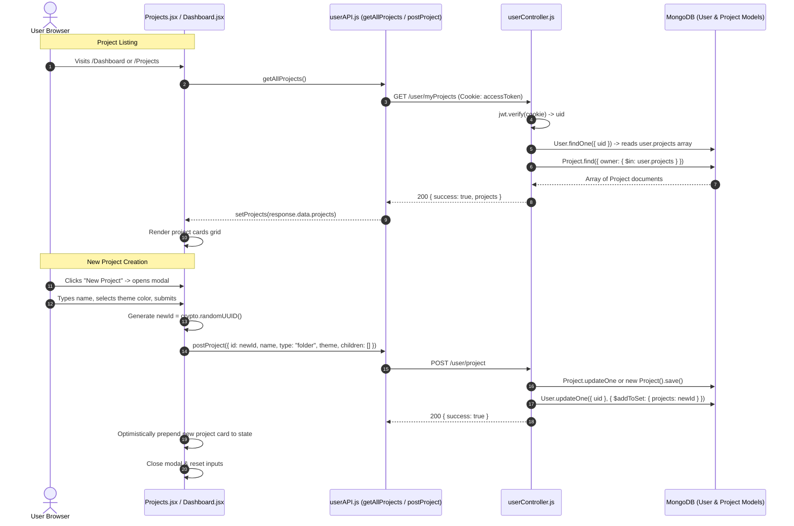

# Feature Trace — Project Library & Dashboard

This document details the complete end-to-end execution flow of the user dashboard (`/Dashboard`) and project management library (`/Projects`), covering project retrieval, search filtering, color theme customization, and project creation.

---

## 1. Feature Architecture Overview

The project library lets authenticated users manage their personal workspaces:
* **Dashboard (`/Dashboard`)**: Provides a welcome overview, quick workspace statistics (total project counts), and a grid of recent projects (up to 6).
* **Projects Library (`/Projects`)**: Displays all owned projects in a responsive grid, with real-time client-side search filtering and a modal to create new projects with custom color accents.
* **Navigation Bridge**: Clicking any project card passes project metadata into route state and navigates to the IDE workspace (`/project/:id`).

---

## 2. Sequence Diagram



---

## 3. Step-by-Step Execution Traces

### Flow A: Fetching User Projects (`GET /user/myProjects`)
1. **Trigger**: Mounted in `useEffect` on both `/Dashboard` and `/Projects`.
2. **API Request**: Calls `getAllProjects()` (`client/src/API/userAPI.js`):
   - Method: `GET`
   - URL: `http://localhost:8181/user/myProjects`
   - Cookies: Browser attaches `accessToken` automatically.
3. **Backend Controller (`userController.js:214`)**:
   - Reads `req.cookies.accessToken`. If missing, returns `401 Unauthorized`.
   - Verifies JWT: `const { uid } = jwt.verify(token, process.env.JWT_SECURITY_KEY)`.
   - Looks up user document: `const { projects } = await User.findOne({ uid })`.
   - Executes batch project query:
     ```javascript
     const projectsData = await Project.find({
       owner: { $in: projects }
     });
     ```
   - **DEAD CODE BRANCH (FP-11)**:
     ```javascript
     if (projects && projects.matchedCount === 0) {
       return res.status(400).json({ success: false, message: "no projects found" });
     }
     ```
     `projects` is a JavaScript array of strings. Arrays do not have a `matchedCount` property (`projects.matchedCount` is `undefined`). This condition is always false.
   - Returns `200 OK` with `{ success: true, projects: projectsData }`.
4. **Client State Hydration**:
   - In `Projects.jsx:32`: `setProjects(response.data.projects)`.
   - In `Dashboard.jsx:17`: `setProjects(response.data.projects)` and `setRecentProjects(response.data.projects.slice(0, 6))`.

---

### Flow B: Client-Side Project Search Filtering
In `client/src/pages/Projects.jsx:23`:
```javascript
const filteredProjects = projects.filter((p) =>
  p.rootNode.name.toLowerCase().includes(search.toLowerCase())
);
```
* As the user types into the search box, `search` state updates.
* Filtering executes synchronously in memory without additional network requests.
* If no items match, an empty-state illustration and feedback message are rendered.

---

### Flow C: Creating a New Project
1. **User Action**: Clicks "New Project" card in `Projects.jsx`, opening the modal.
2. **Customization**:
   - User types project name into `<input>` (updates `newProjectName`).
   - User picks from palette of 6 theme colors (`THEME_COLORS`):
     - Violet (`#7c3aed`), Slate (`#64748b`), Sage (`#4d7c5f`), Indigo (`#4f46e5`), Rose (`#9f4255`), Teal (`#0f766e`).
3. **Form Submission (`handleCreateProject`)**:
   - Generates client-side UUID: `const newId = crypto.randomUUID()`.
   - **CRITICAL ORDERING BUG (FP-10)**:
     ```javascript
     postProject({
       id: newId,
       name: newProjectName || "IDEas Project",
       type: "folder",
       theme: selectedColor.hex,
       children: [],
     });
     if (!newProjectName.trim()) return; // <-- Validation check executed AFTER API dispatch!
     ```
     If the user submits whitespace, `postProject` fires an asynchronous request to the server, creating a phantom `"IDEas Project"` in MongoDB, but the UI returns early and does not update local state or close the modal.
4. **Backend Processing (`userController.js:171`)**:
   - Saves initial empty folder structure in MongoDB `projects` collection with `owner: newId`.
   - Appends `newId` to user's `projects` array via `$addToSet`.
5. **Optimistic Client Update**:
   - If name is valid:
     ```javascript
     const newProject = {
       rootNode: {
         id: newId,
         name: newProjectName,
         language: "Code",
         date: "Just now",
         theme: selectedColor.hex,
       },
     };
     setProjects([newProject, ...projects]);
     setNewProjectName("");
     setIsModalOpen(false);
     ```
   - New card appears immediately at the front of the grid with its colored top accent bar.

---

### Flow D: Navigating to Project Workspace
Each project card in the grid is a React Router `<Link>`:
```jsx
<Link
  to={`/project/${project.rootNode.id}`}
  state={{ name: project?.rootNode.name }}
  key={project.rootNode.id}
>
  ...
</Link>
```
* Navigates to `/project/:id`.
* Passes project name via navigation state so `Project.jsx` can render the title immediately while `getProjectById` is in flight.

---

## 4. Debugging Checkpoints

* **Pre-Validation Save (FP-10)**: In `Projects.jsx`, submit an empty form; check MongoDB to observe that an unannounced project was saved to the database.
* **Dead Code on Zero Projects (FP-11)**: Calling `getAllProjects` for a new user with zero projects returns `200 OK` with `projects: []` (not 400).
* **Unused Component State**: Line 16 of `Projects.jsx` declares `const [id, setId] = useState()`, which is never read or written.

---

## Next Steps & References
* For the workspace loaded by clicking a project card, see [features/project-workspace.md](./project-workspace.md).
* For authentication and session management, see [features/auth-and-session.md](./features/auth-and-session.md).
