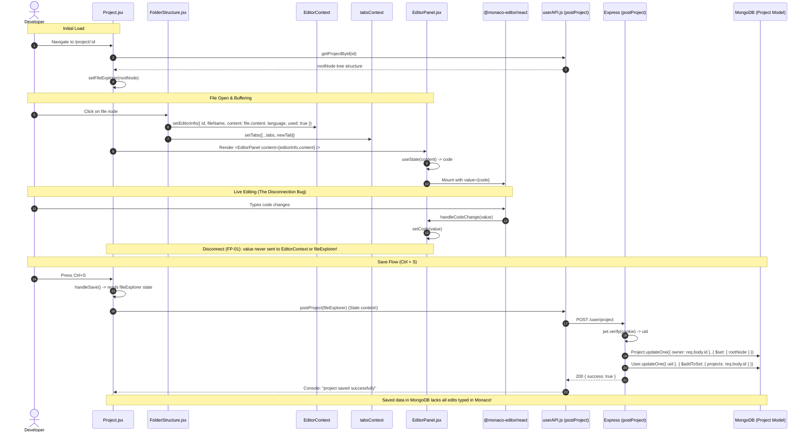

# Feature Trace — Project Workspace & File Explorer

This document details the complete end-to-end execution flow for the multi-file IDE workspace (`/project/:id`), covering project loading, recursive tree mutations, file opening, tab management, Monaco Editor embedding, and the workspace persistence pipeline.

---

## 1. Feature Architecture Overview

The project workspace provides a complete IDE environment in the browser:
* **Sidebar**: Displays a recursive virtual filesystem (`FolderStructure.jsx`) with create, rename, and delete actions.
* **Header / Tab Bar**: Displays open files as clickable tabs (`Tabs.jsx`).
* **Editor Stage**: Renders Monaco Editor (`EditorPanel.jsx`) with syntax highlighting and custom futuristic themes.
* **Persistence Engine**: Listens for `Ctrl+S` / `Cmd+S` keyboard shortcuts in `Project.jsx` and commits the tree to MongoDB via `POST /user/project`.

---

## 2. Sequence Diagram



---

## 3. Step-by-Step Execution Traces

### Flow A: Project Workspace Initialization
1. **User Action**: Navigates to `/project/:id` (e.g. from the Dashboard or Projects library).
2. **Component & Hooks**: `client/src/pages/Project.jsx`:
   - `const { id } = useParams()` extracts the project UUID.
   - `const location = useLocation()` reads optional project name from navigation state.
3. **Project Fetch (`useEffect`)**:
   - Calls `getProjectById(id)` (`client/src/API/userAPI.js`).
   - Dispatches `GET http://localhost:8181/user/project/:id`.
   - Backend `getProject` controller queries `Project.findOne({ owner: id })`.
   - On success: Calls `setFileExplorer(response.data.project.rootNode)`.
   - On failure (or new project): Initializes fallback root node:
     ```javascript
     setFileExplorer({
       id: id,
       name: fileName || "IDEas Project",
       type: "folder",
       theme: "yellow",
       children: []
     });
     ```

---

### Flow B: Recursive Tree Mutations (Create, Rename, Delete)
Defined as pure recursive functions in `Project.jsx`:

1. **Node Insertion (`insertNode`)**:
   - User hovers folder, clicks "New File" or "New Folder", types name, and hits Enter.
   - Calls `getLanguageConfig(ext)` (`client/src/utils/languageConfig.js`) to get language ID and starter boilerplate.
   - Creates new item:
     ```javascript
     const newItem = {
       id: crypto.randomUUID(),
       name: newItemName.trim(),
       language: isFolder ? null : monacoLang,
       type: isFolder ? "folder" : "file",
       ...(isFolder ? { children: [] } : { content: boilerplate })
     };
     ```
   - Invokes `handleInsertNode(folderId, newItem)`. Recursively locates target folder and prepends `newItem` to `children`.
2. **Node Rename (`renameNode`)**:
   - Right-click node $\rightarrow$ "Rename" $\rightarrow$ Enter.
   - Recursively traverses tree; updates `name: newName` when `tree.id === folderId`.
3. **Node Deletion (`deleteNode`)**:
   - Right-click node $\rightarrow$ "Delete".
   - Recursively traverses tree; filters out matching `id`.

---

### Flow C: Opening Files & Tab Management
1. User clicks file node in `FolderStructure.jsx`:
   - `handleClick()` runs if `fileExplorer.type !== "folder"`.
2. Sets active editor descriptor:
   ```javascript
   const newTab = {
     id: fileExplorer.id,
     fileName: fileExplorer.name,
     content: fileExplorer.content,
     language: fileExplorer.language,
     used: true
   };
   setEditorInfo(newTab);
   ```
3. Appends to open tab strip if not already open:
   ```javascript
   if (!tabs.find((tab) => tab.id === fileExplorer.id)) {
     setTabs([...tabs, newTab]);
   }
   ```
4. `Project.jsx` observes `editorInfo.used === true` and renders:
   ```jsx
   <EditorPanel
     fileName={editorInfo.fileName}
     content={editorInfo.content}
     language={editorInfo.language}
   />
   ```
5. User clicks tab in `Tabs.jsx`: Calls `setEditorInfo(tab)`, switching active file.
6. User clicks `X` on tab: Removes tab from `tabs`. If active, activates last remaining tab or resets `used: false` to show empty workspace graphic.

---

### Flow D: Code Editing & Workspace Persistence (The Data-Loss Bug)
1. **User Types Code**: User types in Monaco Editor.
2. `EditorPanel.jsx:21` receives event:
   ```javascript
   const handleCodeChange = (value) => {
     setCode(value || "");
   };
   ```
   **CRITICAL DEFECT (FP-01)**: `value` is stored only in `EditorPanel` local `code` state. It is never emitted to `EditorContext` or `Project.jsx`'s `fileExplorer`.
3. **User Presses `Ctrl+S` / `Cmd+S`**:
   - `Project.jsx:142` keyboard event listener triggers `handleSave()`.
   - Invokes `postProject(fileExplorer)`:
     - Transmits `fileExplorer` state, which **still contains initial boilerplate or empty content**.
4. **Backend Processing (`userController.js:171`)**:
   - Reads `req.cookies.accessToken`, verifies JWT to obtain user `uid`.
   - Updates project document:
     ```javascript
     await Project.updateOne({ "owner": req.body.id }, { $set: { rootNode: req.body } });
     await User.updateOne({ uid }, { $addToSet: { projects: req.body.id } });
     ```
   - If not found (`matchedCount === 0`), creates `new Project({ owner: req.body.id, rootNode: req.body }).save()`.
   - Returns `200 OK` with `{ success: true, message: "project saved successfully" }`.
5. **Outcome**: Both client and server report success, but the saved `content` strings in MongoDB are completely stale. Reloading the page discards all typed edits.

---

## 4. Debugging Checkpoints

* **Monaco State Isolation (FP-01)**: Inspect network payload of `POST /user/project` on `Ctrl+S`; confirm `content` lacks recent keystrokes.
* **Top Sidebar Toolbar Buttons (FP-12)**: The two SVG buttons in `Project.jsx` header (lines 221-256) lack `onClick` handlers.
* **Unauthenticated Read (FP-08)**: Direct GET to `http://localhost:8181/user/project/:id` returns project tree without cookies.
* **Horizontal Privilege Escalation (FP-07)**: Sending someone else's project ID in `postProject` overwrites their project.

---

## Next Steps & References
* For the standalone compiler execution pipeline, see [features/code-execution-engine.md](./code-execution-engine.md).
* For failure reproduction steps, see [09-debugging-playbook.md](../09-debugging-playbook.md#playbook-1-project-edits-not-persisting-fp-01).
